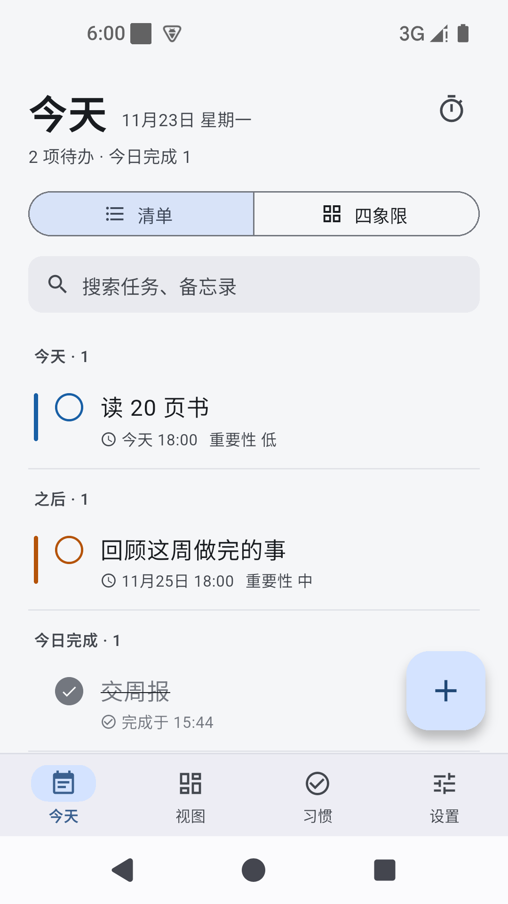
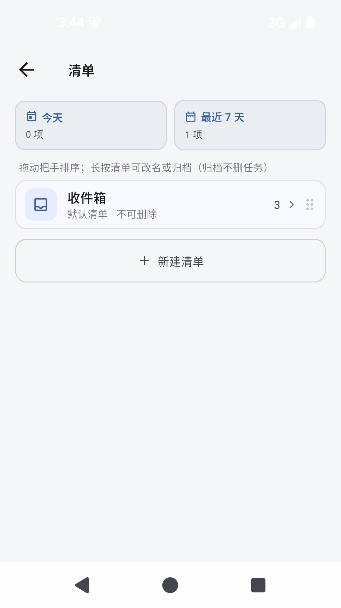
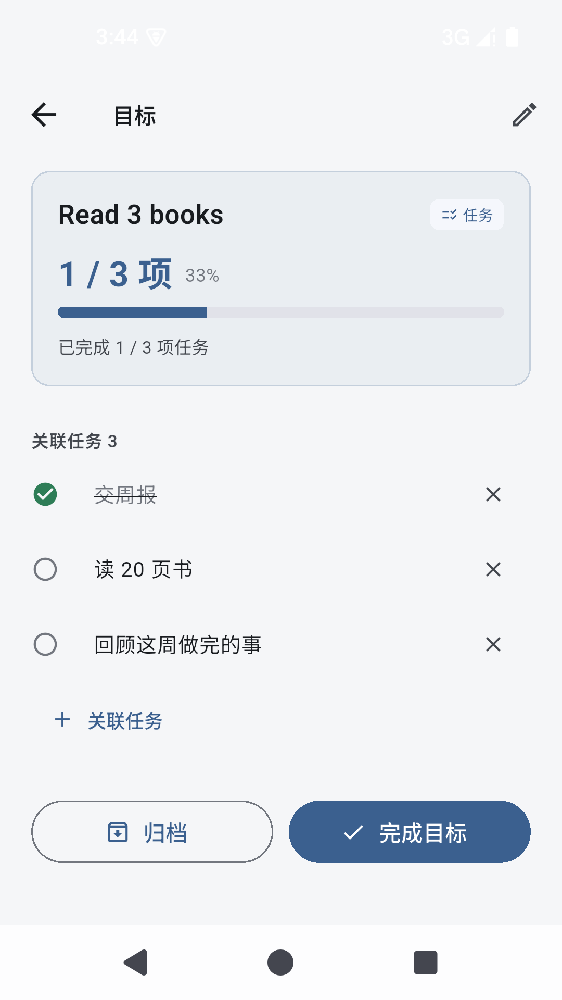
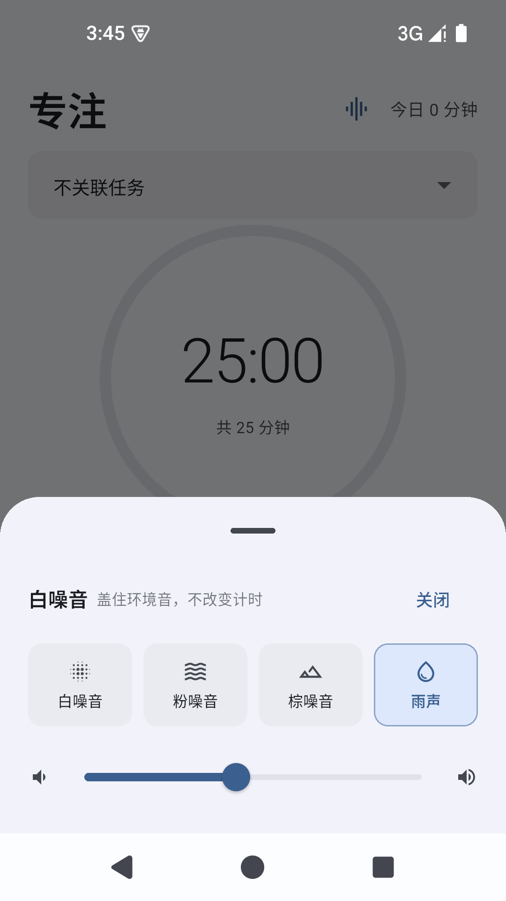

# Pace

**A local-first to-do, habit and focus app.** Android + Windows, built with Flutter.
No account, no network permission, no telemetry — everything lives in a SQLite file on your device.

<p>
  
  
  
  
</p>

## Why another to-do app

Most to-do apps solve *multi-device sync*, and charge you an account, a subscription and a pile of
collaboration features you never asked for. Pace solves a different problem:

> Open it and see what today looks like. Close it and it asks nothing of you.

## Features

- **Tasks** — lists, tags, subtasks, priorities, repeat rules, reminders, trash with 30-day restore,
  one-line quick add (`tomorrow 3pm !high #tag`).
- **Habits** — daily / weekly / monthly / every-N-days schedules, target counts, notes on check-in,
  streaks, archive without losing history.
- **Focus** — countdown or count-up, focus → short break → next round cycles, white / pink / brown / rain
  noise generated at runtime (no audio assets), a floating pill that follows you across pages.
- **Goals** — one goal aggregates tasks, habits or focus minutes into a single progress bar.
- **Daily log** — mood check-in, five-level stats, a timeline of what actually happened, one-line summary.
- **Views** — dashboard, calendar (month / 3-day / week), board with drag & drop, cards, Eisenhower matrix.
- **Local by design** — JSON / ZIP backup and restore, no login, no analytics, no `INTERNET` permission.

## Tech

| Layer | Choice |
| --- | --- |
| UI | Flutter 3.x, Riverpod 3 |
| Storage | Drift (SQLite), schema v6 |
| Notifications | flutter_local_notifications + Android foreground service for focus |
| i18n | `lib/core/i18n` — a 700-entry map, no codegen |

## Build

```bash
cd app
flutter pub get
dart run build_runner build --delete-conflicting-outputs   # only after changing Drift tables
flutter run                       # debug on a connected device
flutter build apk --release       # → build/app/outputs/flutter-apk/app-release.apk
```

A release build is signed with `android/key.properties` + `android/app/release-key.jks` if both exist;
otherwise it falls back to the debug key so `flutter build apk --release` still works on a fresh clone.

Windows: `flutter build windows` inside `app/` (see `scripts/build_windows.ps1`).

## Project layout

```
app/
  lib/
    app/          theme, color tokens
    core/         db (Drift), i18n, backup, ui primitives
    features/     tasks / habits / focus / goals / log / memos / views / stats / settings
    platform/     notification + foreground service bridges
  test/           80 tests: repositories, flows, i18n, perf baseline
  tools/          translation sources + generator (see below)
docs/             design notes (Chinese), screenshots, release checklist
preview/          static HTML mockups used before coding
```

## Internationalization

Chinese and English ship in the same build; switch it in **Settings → Language**.

Translations are plain Dart maps keyed by the Chinese source string, so a missing entry degrades to
Chinese instead of showing a broken key:

```dart
tr('今天')                      // "Today"
trf('{} 项', [3])               // "3"
trf('{} 年 {} 月', [2026, 11])  // "11/2026"  (indexed placeholders allow reordering)
trCount(2, '个清单', 'list', 'lists')  // "2 lists"
```

The English map (`app/lib/core/i18n/en.dart`) is **generated** — edit `app/tools/tr_*.py` and run:

```bash
cd app && python tools/gen_en.py --write
```

`app/tools/scan_cn.py` audits coverage: it walks the Dart sources and reports any Chinese literal that
is not wrapped in `tr()` / `trf()`.

## Privacy

- No login, no account, no server. Nothing is uploaded.
- The app requests **no network permission**. Permissions used: notifications, exact alarms,
  restart-on-boot (to restore reminders) and a foreground service (focus timer).
- Runtime logs stay in memory and are cleared on exit; task titles, note bodies and mood notes are never logged.

## Known limits

- Android release signing keys are not in this repo — build your own.
- Windows build is not part of the CI/release artifacts here.
- Notification action buttons may need the app to be opened on some Chinese ROMs.
- No cloud sync by design. WebDAV / S3 backup sync is planned, CalDAV is explicitly not.

## License

[MIT](LICENSE)

## 中文说明

**Pace** 是一个本地优先的待办 / 习惯 / 专注应用，Android 与 Windows 共用一套 Flutter 代码。

- 不登录、不联网、不上传；数据全在本机 SQLite 里，备份是唯一的外部副本。
- 任务（清单 / 标签 / 子任务 / 重复 / 提醒 / 回收站）、习惯（周期 / 次数 / 心得 / 连续天数）、
  专注（正倒计时 / 短休循环 / 白噪音 / 悬浮胶囊）、目标（任务·习惯·专注·手动四种进度）、
  日志（心情 / 时间线 / 每日总结）、五种视图（工作台 / 日历 / 看板 / 卡片 / 四象限）。
- 中英双语，设置里一键切换；界面文案的英文表由脚本生成，缺词会回退中文而不是显示 key。
- 设计文档在 `docs/`，编码前的手绘预览在 `preview/`。

构建方式见上方 **Build**，语言与翻译见 **Internationalization**。

## 致谢

交互与信息架构参考了思源笔记的 Pinch 插件和成熟的app；
配色思路参考 [PaletteMaker](https://palettemaker.com)。代码为独立实现。
